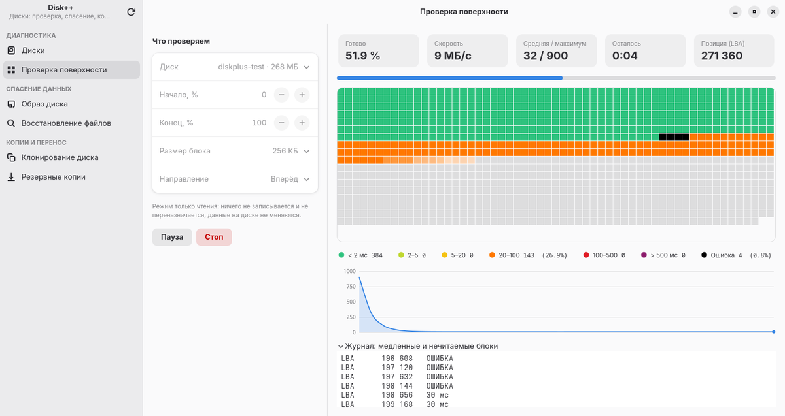
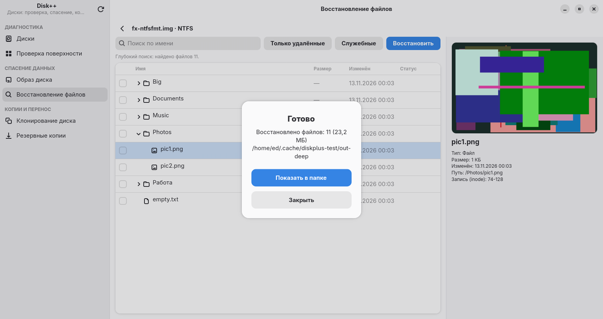
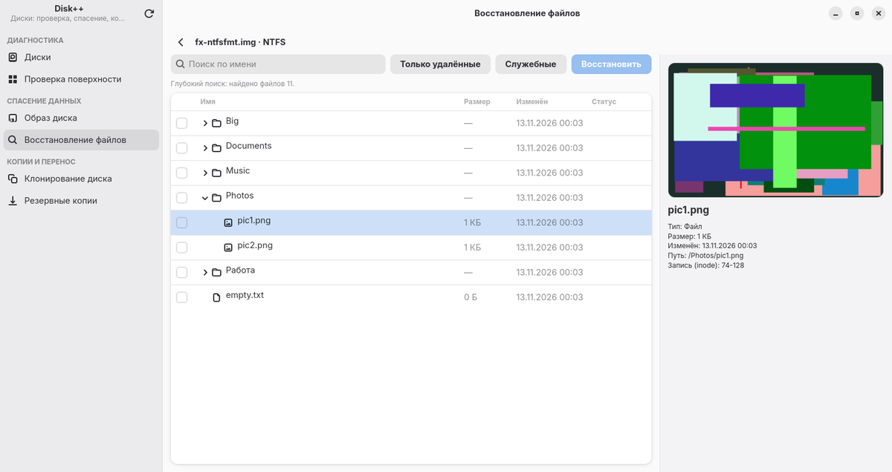
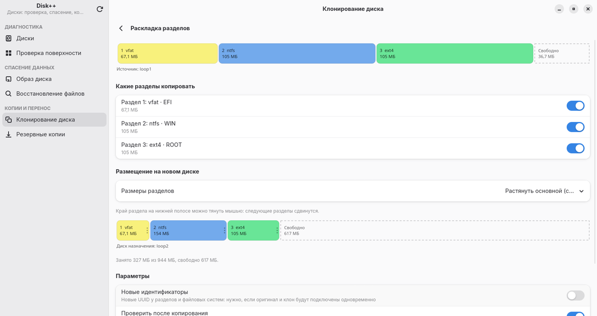
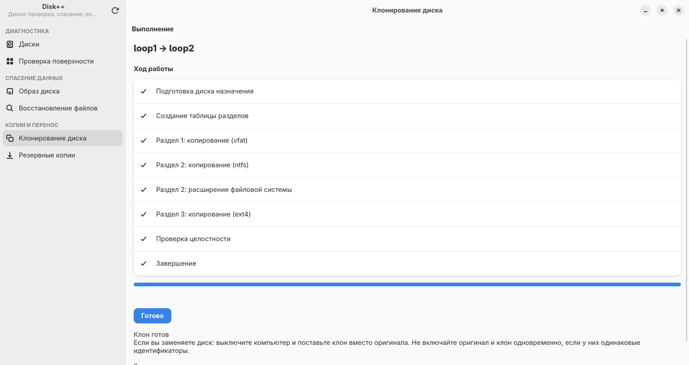

# Disk++

**All-in-one disk toolkit for Linux** (GTK4 / libadwaita): disk health and surface scan, imaging of dying drives,
file recovery (including after formatting), disk cloning and compressed backups. Russian UI.

> English summary: Disk++ combines SMART health scoring, a Victoria-style surface scanner, ddrescue imaging,
> Sleuth Kit / own deep-scan file recovery (NTFS, FAT32, exFAT, ext*), PhotoRec carving, partclone-based disk
> cloning with a drag-to-resize partition layout editor, and zstd-compressed verified backups.
> Arch/CachyOS: one-file installer in the Releases. Other distros: see below (untested). MIT license.



| | |
|---|---|
|  |  |
|  |  |

Программа для работы с дисками на Linux (GTK4 / libadwaita): всё в одном окне.

| Раздел | Что делает |
|---|---|
| **Диски** | здоровье накопителей в процентах (SMART), температура, наработка, карта разделов |
| **Проверка поверхности** | чтение диска с замером времени каждого блока (как Victoria), живая карта, график скорости. Только чтение |
| **Образ диска** | копирование умирающего диска через ddrescue с картой, паузой и продолжением |
| **Восстановление файлов** | дерево папок с предпросмотром, удалённые файлы (NTFS, FAT, exFAT, ext), глубокий поиск после форматирования, поиск по сигнатурам (PhotoRec) |
| **Клонирование диска** | копия диска целиком с редактором раскладки (перетаскивание размеров), **уменьшение** и расширение разделов (перенос большого диска на меньший SSD) |
| **Резервные копии** | сжатые образы разделов с контрольными суммами, проверка, восстановление, просмотр содержимого |

## Установка

- **Arch / CachyOS / Manjaro:** скачайте `disk-plus-installer.run` из раздела [Releases](https://github.com/edgarsskills-fix/disk-plus/releases) и выполните `bash disk-plus-installer.run`.
  Пакет ставится через `pacman -U`, зависимости подтягиваются автоматически.
- **Debian / Ubuntu / Fedora:** тот же установщик установит зависимости через `apt`/`dnf`
  (**не проверено на этих системах**, нужна libadwaita 1.5 или новее).

Удаление: `bash disk-plus-installer.run --remove` (или `sudo pacman -R disk-plus`).

## Как уменьшаются разделы

Исходный диск не меняется. Раздел разворачивается во временный файл (нужно свободное место на *другом* диске,
примерно по размеру занятых данных), файловая система уменьшается там (`ntfsresize` / `resize2fs`), и только потом
результат записывается на новый диск. После уменьшения NTFS Windows при первой загрузке сделает проверку тома (chkdsk), это нормально.

## Безопасность

Программа, которая пишет на диски, должна быть осторожной:
- права администратора получает только отдельный помощник (`pkexec`), он принимает ограниченный набор команд;
- источник всегда читается только на чтение;
- клонировать и восстанавливать можно только на **отмонтированный, не системный** диск, и только после ввода имени диска;
- перед записью показывается, что именно будет стёрто; минимальный размер при уменьшении проверяется с запасом;
- все опасные операции проверены автотестами на виртуальных дисках (`tests/`, `tools/`).

## Ограничения

Не умеет: клонировать работающую систему, править загрузчик после переноса, уменьшать разделы FAT/exFAT/btrfs/XFS
(уменьшаются NTFS и ext2/3/4), восстанавливать удалённые файлы ext4/btrfs/XFS. Часть проверена только на виртуальных дисках и одной флешке.
Не используйте как единственную копию важных данных.

## Разработка

```
sudo python3 tools/make_fixtures.py        # тестовые образы с файловыми системами
sudo tools/testdisk.sh up                  # виртуальный «больной» диск
python3 tests/test_recovery.py             # и другие tests/test_*.py
bash packaging/build.sh                    # собрать пакет и установщик в dist/
```

## Лицензия

MIT, см. файл `LICENSE`. Внешние программы (ddrescue, partclone, Sleuth Kit, TestDisk/PhotoRec и др.) запускаются как отдельные процессы и распространяются по своим лицензиям.
